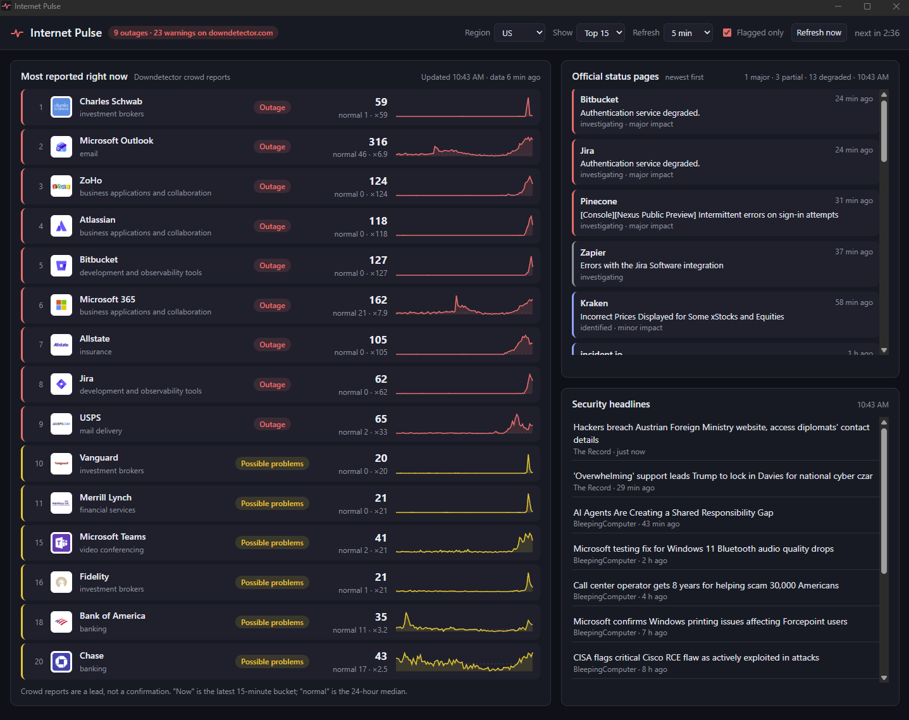
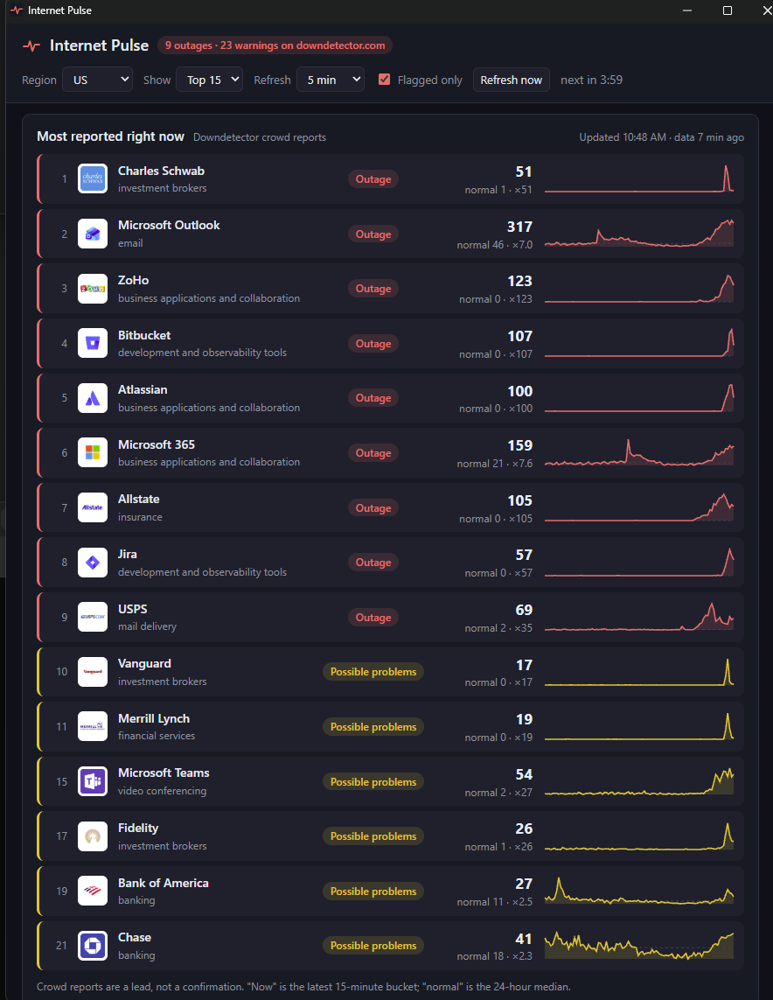

# Internet Pulse

An ad-free, dark-mode Chrome extension that gives you a live, at-a-glance view of what's breaking on the internet right now.

## What it shows

- **Most reported right now:** the top 5, 8, 10 or 15 services from Downdetector's "most reported" list for the US, UK or Canada. Each row shows Downdetector's own flag (Outage, Possible problems or Normal), the latest 15-minute report count against the 24-hour median, and a 24-hour trend line. A "Flagged only" switch hides services marked Normal. Click a name to open its Downdetector page.
- **Official status pages:** open incidents from 250+ providers' own status pages (via the free [Some Systems Operational](https://somesystemsoperational.com) API), newest first.
- **Security headlines:** the latest stories from BleepingComputer and The Record.

It refreshes every 5 minutes by default (3 to 15 minutes, adjustable). Settings are remembered. Crowd reports and official status sit side by side, so you can see when a crowd spike is confirmed by the provider, or when a provider's page still says everything is fine.

## Install

1. Download or clone this repository.
2. In Chrome, open `chrome://extensions` and turn on **Developer mode**.
3. Click **Load unpacked** and select the repository folder.
4. Pin **Internet Pulse** from the puzzle-piece menu and click its icon. The dashboard opens in its own window.

If the Downdetector panel says it needs a browser check, open downdetector.com once in a normal tab, let it load, then press **Refresh now**.

## How it works

- Downdetector: reads the public homepage the same way your browser does (with your browser's own session) and parses the embedded "top companies" data. No API key.
- Status pages: `https://somesystemsoperational.com/api/v2/summary.json`.
- Headlines: the public RSS feeds of BleepingComputer and The Record.

No data is collected or sent anywhere. The only stored data is your display settings, in Chrome's local extension storage.

## Notes

- Crowd reports are a lead, not a confirmation.
- Downdetector's terms may not permit automated reading of its site. This is intended for light personal use; the default refresh is a few requests per hour.
- If Downdetector changes its page layout, the left panel will show an error until the parser is updated. The other panels keep working.
- Not affiliated with Downdetector, Ookla, Some Systems Operational, BleepingComputer or The Record.
